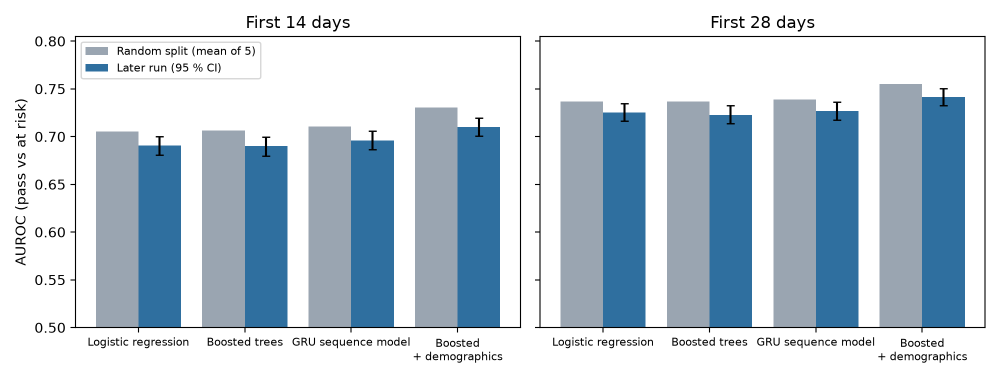
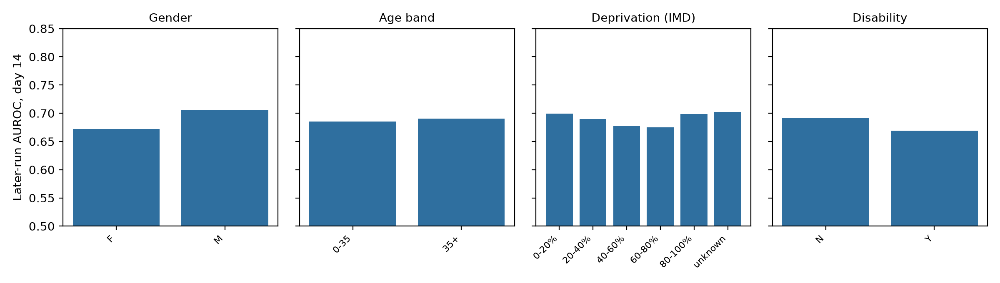

# Early-warning models on a later course run

**Question.** Can a student's first 2–4 weeks of activity predict whether they pass, when the model is tested on a
later run of the course rather than on a random split of the same students? And is it equally accurate for every
group of students?

Data: OULAD, the Open University Learning Analytics Dataset (Kuzilek et al., 2017), CC BY 4.0. The analysis plan
([ANALYSIS_PLAN.md](ANALYSIS_PLAN.md)) was committed before the data was downloaded; every change since is in its
deviation log.

## Setup

* **Who:** 28,119 enrolments still registered on day 14 (27,538 on day 28), in the six modules that ran in both
  2013 and 2014.
* **Later run:** train on the 2013 presentations (12,092 enrolments), test on the 2014 ones (11,710), with every
  student who appeared in 2013 removed from the test set.
* **Random split:** the same enrolments, split by student with the same test fraction, 5 seeds.
* **Outcome:** Pass or Distinction vs Fail or Withdrawn. Test pass rate 59 %.
* **Models:** logistic regression, gradient-boosted trees (primary), a GRU over daily clicks, and gradient-boosted
  trees that also see demographics. Settings fixed in the plan; nothing tuned on a test set.

## Results

Full tables: [results/RESULTS.md](results/RESULTS.md). Numbers: [results/summary.json](results/summary.json).



1. **Testing on a later run costs a little, not a lot.** Gradient-boosted trees at day 14: AUROC 0.690
   [0.679, 0.700] on the later run vs 0.707 on random splits, a drop of 0.017 [0.006, 0.028] (H1 supported,
   p = 0.001). Every model drops by 0.011–0.020. The random split overstates accuracy, but only slightly here.
2. **Two more weeks help more than a better model.** Day 28 beats day 14 by 0.035 [0.028, 0.043] AUROC on the same
   students (H2 supported). The GRU beats logistic regression by at most 0.005, inside the noise.
3. **Early prediction is weak.** No model reaches 0.75 on the later run. At the planned threshold (flag when
   P(pass) < 0.5), the primary model misses about half of the students who go on to fail or withdraw.
4. **The gaps are by gender and age.**
   * Women: AUROC 0.672 vs 0.706 for men at day 14 (gap 0.034 [0.015, 0.055]), and more at-risk women are missed
     (56 % vs 51 %).
   * Students over 35: about the same AUROC, but 60 % of those at risk are missed vs 51 % for under-35s
     (gap 0.090 [0.059, 0.117]). The model ranks them as well but its threshold suits them worse.
   * Deprivation and disability: gaps of 0.02–0.03 AUROC with wide intervals.
5. **Adding demographics raises AUROC by about 0.02** (0.710 vs 0.690 at day 14). That is the accuracy cost of
   leaving them out, and it is the trade-off an early-warning system would have to decide on.



### Post hoc: a threshold chosen from the training data

Added after seeing the results above, and labelled so in the deviation log. The threshold is set on out-of-fold
training predictions so that 80 % of at-risk training students would be flagged, then applied unchanged to the
later run ([src/oulad/threshold.py](src/oulad/threshold.py), [results/threshold.json](results/threshold.json)).

* **Day 14:** 25 % of at-risk students are missed (aimed at 20 %: the later run costs here too), but 60 % of all
  students are flagged, including half of those who go on to pass. Two weeks of clicks cannot separate them well.
* **The gender gap in missed students disappears** (−0.016 [−0.043, 0.008]), so it came from the 0.5 threshold.
* **The age gap does not:** 31 % of at-risk students over 35 are missed vs 23 % under 35 (gap 0.088
  [0.057, 0.115]); at day 28, 25 % vs 18 %. Older students who are going to fail or withdraw look more like
  students who pass in their early clicks, whatever the threshold.

## Limitations

* **One institution, one pair of years.** The Open University in 2013–2014. "Later run" means one year later, with
  the same modules.
* **Group-gap intervals are biased upward.** The gap is the largest minus the smallest level, so noise always makes
  it look bigger, and the bootstrap inherits that. For the six deprivation levels the point estimate even falls
  below its interval. Treat those intervals as rough; the two-level gaps (gender, age, disability) are less affected.
* **The 0.5 threshold was fixed in advance and is poor** for a 59 % pass rate. A real system would pick it from the
  cost of missing a student, which would change every miss rate above.
* **Withdrawal is counted as "at risk".** Some students withdraw for reasons a click log cannot show.
* **Scores of tutor-marked assessments are not used,** because OULAD does not say when they were marked.

## Reproduce

```bash
python -m venv .venv && .venv/Scripts/pip install -r requirements.txt   # torch from the CPU index
# put the seven OULAD CSV files in data/raw/ and check them against data/SHA256SUMS.txt
cd src
python -m oulad.features   # feature tables for days 14 and 28 (about 30 s)
python -m oulad.run        # all models, splits and bootstraps (about 15 min on a laptop CPU)
python -m oulad.report     # results/RESULTS.md and the figures
python -m oulad.threshold  # post hoc threshold analysis (about 1 min)
```

## Licence

Code: MIT. The OULAD data is not redistributed here; cite:

> Kuzilek, J., Hlosta, M. and Zdrahal, Z. (2017). Open University Learning Analytics dataset.
> *Scientific Data*, 4, 170171.
